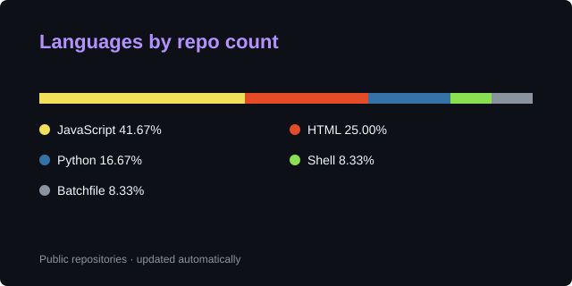

# Mohammed Sellami

### Builder of practical products, resilient bots, and developer tools

I build software with a focus on useful workflows, thoughtful UX, and reliable systems. I enjoy turning ideas into products that people can actually use—from study planning tools to open-source Discord infrastructure.

## What I’m building

### [BAC on Track](https://bac-on-track.vercel.app)
A tracking-first study platform for Tunisian Bac students. It combines onboarding, manual study logging, Focus/Stopwatch sessions, progress dashboards, subject and chapter activity, scheduled reviews, and a public trial timer.

**Product:** [bac-on-track-offcial-website](https://bacontrack.tn) · **Project:** [DragonsGames/bac-on-track](https://github.com/DragonsGames/bac-on-track)

### [BigV](https://github.com/DragonsGames/BigV)
An open-source Discord verification bot built with Python, discord.py, SQLite, and Pillow. BigV provides private CAPTCHA-style verification, secure role assignment, persistent UI, multi-server support, self-healing configuration, and administrator tooling.

**Repository:** [github.com/DragonsGames/BigV](https://github.com/DragonsGames/BigV)

## Current toolkit

`TypeScript` · `JavaScript` · `Python` · `Next.js` · `React` · `Supabase` · `PostgreSQL` · `Discord Bots` · `Automation`

## Open to

- Building useful products from early idea to production
- Collaborating on developer tools and open-source projects
- Improving reliability, security, accessibility, and user experience

  

  

---

  Explore my repositories and follow along with what I’m building.

